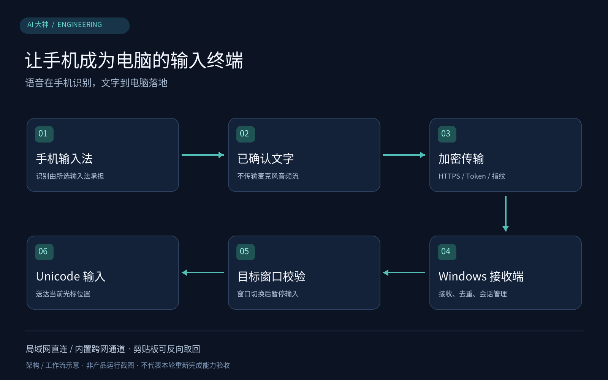

# 手机语音输入电脑 · VoiceInput2PC

**不买麦克风、不传音频流，直接用口袋里的手机输入法向电脑光标位置安全口述文字。**

复用安卓手机现成输入法完成语音转文字，通过 HTTPS、专用令牌与证书指纹固定（跨网内置 Tailcat/WireGuard 数据面）将确认文本加密送达 Windows 接收端，以 Unicode 键盘输入直接打入绑定窗口光标处。

> 图2：VoiceInput2PC 局域网/Tailcat跨网双通道传输与Windows窗口句柄绑定注入架构示意图（基于v0.5.0/v0.6.1源码架构绘制，非实机截图）

## 它如何工作

采用“音频识别外置、纯文本加密透传”的轻量化架构，复用安卓系统既有输入法的语音转写能力，避免在PC端部署庞大ASR模型或采集原始音频流。安卓端捕获输入法确认后的增量文本，经HTTPS连接（辅以专用令牌与证书指纹固定）推送至Windows接收端；跨网场景下则由内嵌Tailcat组件建立WireGuard数据面（支持NAT穿透与DERP中继回退）。Windows端校验消息序号去重后，绑定初始目标窗口句柄并通过Win32 SendInput注入Unicode字符流。

## 核心技术与工程取舍

| 技术机制 | 为什么这样做 |
| --- | --- |
| 外置ASR与增量文本Diff提取 | 本应用无需申请麦克风权限，也不必部署 ASR 模型；识别算力与联网行为由用户选用的手机输入法承担。已发送前缀被改写时暂停核对，避免误删电脑文本。 |
| Win32 Unicode键盘注入与窗口句柄绑定 | 通过 Unicode 键盘输入减少对剪贴板的占用；输入绑定目标窗口，窗口变化时暂停，降低输错位置的风险。 |
| 内置 Tailcat 跨网络数据通道 | 在局域网不可直连时提供 WireGuard / DERP 路径；公司网络、防火墙和配对凭据生命周期仍影响连接，不承诺任意网络免配置可用。 |
| HTTPS证书指纹Pinning与消息ID幂等去重 | 通过 HTTPS、专用令牌和固定证书指纹建立应用层校验；消息编号辅助去重。结果不确定时保留草稿，而非盲目重传。 |

## 一个具体使用场景

用户在Windows中将光标点入Word或IDE代码注释区，手机端开启输入并用系统输入法口述长句，文字跨网实时注入光标处；随后在PC复制一段报错信息点发送，手机端原输入框一键拉取该文本。

## 从这里开始

1. Windows 接收端与手机完成配对。
2. 电脑光标放到目标输入位置，手机开启输入。
3. 用手机输入法口述，确认后的新增文字传到电脑。
4. 切换目标窗口前先暂停；需要取回电脑文字时，明确点击发送剪贴板。

成品版本以 [Releases](https://github.com/AI-Dashen/VoiceInput2PC/releases) 实际文件为准，完整安装与源码步骤见 [USAGE.md](USAGE.md)。

## 实现与验证范围

README记录 Windows 10/11 与 Android 8+ 目标环境；当前源码、候选包和正式发布版本应分别查看。扫码、旁路由及各设备兼容性以对应实测证据为准，不能把目标平台列表当成全覆盖验收。

## 许可证与依赖

见 [LICENSE](LICENSE)。第三方工具、模型及素材保留各自的许可与权利边界。
