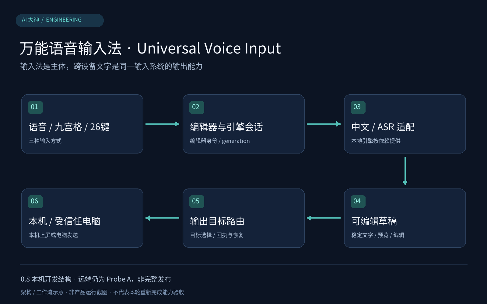

# 万能语音输入法｜Universal Voice Input

[返回项目首页](../README.md)

语音输入法是这个产品的主体，向电脑传输文字是其中的一项输出能力。它不是把旧版手机到电脑传字界面当成系统键盘，也不是旧的 FUTO 派生原型。

> 0.8 本机开发结构示意；不是已发布安装包截图，也不代表当前远端 Probe A 包含全部本机改动。

## 三种交付，分别看待

| 交付 | 当前真实状态 | 获取入口 |
| --- | --- | --- |
| 0.7.0-testing | 2026-10-13 发布的测试版，有 Android APK、Windows ZIP 和 SHA256SUMS；不内置本地语音识别包 | [0.7 测试版下载](https://github.com/AI-Dashen/VoiceInput2PC/releases/tag/v0.7.0-testing) |
| 0.8.0-probe-a | 历史提交 `4862a2f`；本次源码同步前的早期 Probe A | [输入法开发分支](https://github.com/AI-Dashen/VoiceInput2PC/tree/feature/universal-input-v08) |
| 0.8.0-local-input | 本次已同步到 `feature/universal-input-v08`，versionCode 10；含新界面、中文引擎和本地 ASR 适配源码 | [查看本次0.8开发源码](https://github.com/AI-Dashen/VoiceInput2PC/tree/feature/universal-input-v08)；未发布包含私有识别组件的完整APK |

GitHub 的 `/releases/latest` 当前指向 **0.6.1**，因为 **0.7 是预发布**。这是发布频道区别，不代表0.7不存在。本项目不把尚未完成全部验收的测试版改标为稳定版。

## 真正的输入法结构

Android 通过 `InputMethodService` 挂接系统输入框，最终文字经当前有效的 `InputConnection` 提交。`InputSession` 管理草稿、编辑状态与输入模式；编辑器身份与 `generation` 用于使旧录音、旧输入框的异步回调失效，降低切换 App 后串字的风险。

本机后续改动包含：

- **输入方式**：语音、九宫格、26键与符号，使用统一输入会话。
- **中文引擎**：`RimeChineseInputEngine` 与 JNI 适配；引擎、方案和词典有各自依赖及许可。
- **本地语音适配**：`LocalAsrService`、`LocalAsrNative` 和 `OfflineSpeechRecognizer`。独立进程用于生命周期与错误管理，仍共享应用 UID，不能称为网络权限物理隔离。
- **防卡与草稿恢复**：识别超时、错误、取消、输入方式切换、新编辑器切换都有明确状态规则，保留有效草稿并拒绝旧 generation 回调。
- **输出目标**：`OutputTargetController` 将本机上屏和受信任电脑草稿区分；远端发送等待回执，结果未知时使用相同请求 ID 重试。

这些是当前本机源码检查确认的结构。本次已将上述自有源码同步到0.8开发分支；历史 Probe A 提交覆盖较小，不能与最新分支混用。

## 哪些不会随介绍自动公开

本机模型、第三方闭源运行库、原始录音、真实输入内容及凭据不因本次文档整理而上传。引擎接口和产品代码，与模型/运行库的可分发范围分别处理。

## FUTO 原型的关系

`oneplus-offline-voice-input` 是此前基于 FUTO 源码的个人改造实验，用于保留旧路线记录。本仓库的0.8是自有 IME 产品路线；两者的代码状态、许可证及识别能力不混用。

## 源码交付与依赖边界

自有输入法源码、JNI适配、测试、Rime构建脚本和依赖许可证已同步到0.8开发分支。闭源识别模型和运行库未上传；源码可检查，不代表克隆后即可运行完整离线ASR。构建前提和本次实际测试见开发分支的 `docs/v0.8/SOURCE_DELIVERY_2026-10-15.md`。
