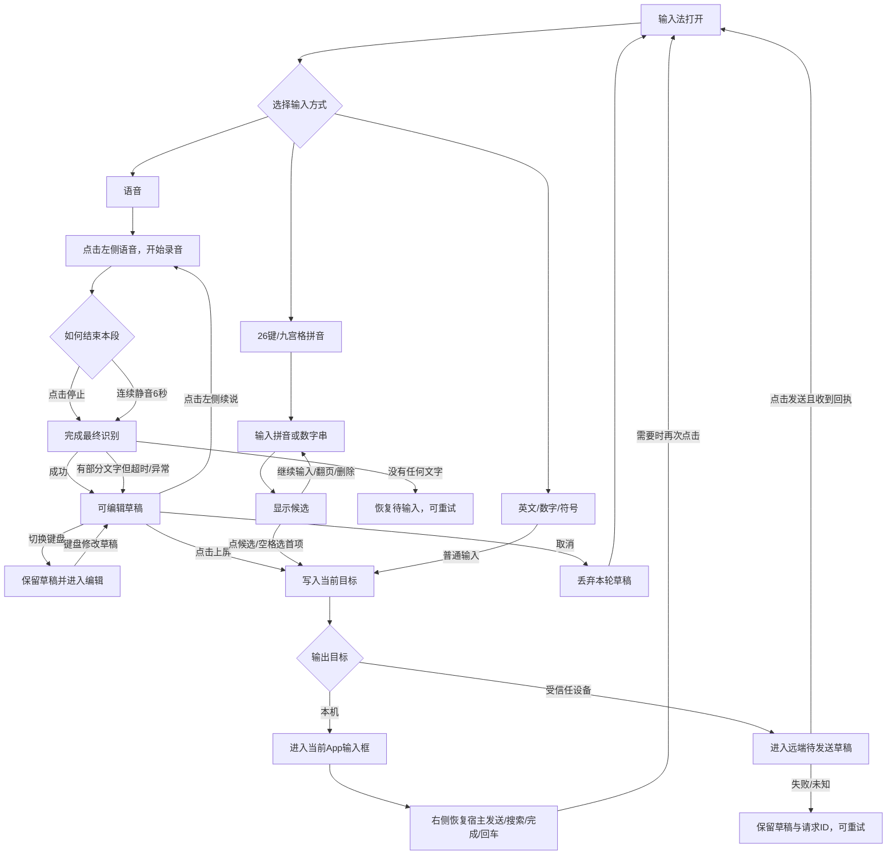

# 万能语音输入法 v0.8｜端到端操作流程基线

日期：2026-10-15  
状态：流程已进入 v0.8.4 实现；连续语音、上屏后宿主动作、长草稿和九宫格稳定性已完成自动化真机验收。外部 App 真人长句体验仍与自动化验收分开记录。

本文不是界面说明，也不是代码状态机说明。它规定用户每完成一步操作后，软件必须进入什么状态、显示什么、文字保存在哪里，以及失败后如何继续。代码和测试必须服从本文。

## 0. 视觉流程交付

`design-v4/01-end-to-end-operation-flow.png` 已于 2026-10-15 被用户判定为 **REJECTED**：它是功能概览，不是逐步操作流程，不再作为实现依据。

新版采用 1 张总览和 5 张逐步操作图。每一行同时写明：用户动作、屏幕/系统状态、文字或数据位置、下一步。

- [流程册总览](design-v5/00-operation-atlas-index.png)
- [01 首次启用与日常进入](design-v5/01-entry.png)
- [02 语音输入完整闭环](design-v5/02-voice.png)
- [03 26键、九宫格与符号](design-v5/03-keyboard.png)
- [04 本机上屏与跨设备发送](design-v5/04-output.png)
- [05 跨App隔离、二级功能与异常恢复](design-v5/05-safety.png)
- [六图缩略总览](design-v5/00-atlas-contact-sheet.png)

新版仍处于用户确认阶段；未确认前不据此修改产品代码。

## 1. 总原则

1. **输入方式**与**输出目标**是两条独立轴：语音、九宫格、26键和符号决定“怎么产生文字”；本机或受信任设备决定“文字去哪里”。
2. **停止录音**、**确认文字**、**切换输入方式**是三个不同动作，不能相互代替。
3. “上屏”只把文字写入当前输入框，不等于发送微信、短信或其他消息。
4. 没有经过用户确认的语音文字始终是草稿；模式切换不得偷偷上屏。
5. 切换App或输入框后，旧会话不得把文字带进新输入框。
6. 任一步失败都必须回到可继续操作的状态，不能卡在“识别中”。

## 2. 总流程图

## 3. 语音输入逐步流程

| 步骤 | 当前状态 | 用户操作或自动触发 | 界面反馈 | 文字保存位置 | 下一状态 |
| --- | --- | --- | --- | --- | --- |
| V00 | 其他输入方式或语音待输入 | 点击左侧“语音” | 立即开始本段录音；右侧变“停止” | 当前输入会话的临时识别区 | 正在录音 |
| V02 | 正在录音 | 用户说话 | 中间区域更新临时识别文字和录音状态 | 临时识别区，不上屏、不记历史 | 正在录音 |
| V03-A | 正在录音 | 点击右侧“停止” | 右侧显示“识别中”并暂时禁用 | 保留当前可见文字 | 正在识别 |
| V03-B | 正在录音 | 连续静音达到6秒 | 自动执行与“停止”相同的动作 | 保留当前可见文字 | 正在识别 |
| V04 | 正在识别 | 引擎返回最终文字 | 显示可编辑文字，并显示“上屏” | 当前输入框专属语音草稿 | 待确认 |
| V05-A | 待确认 | 点击左侧“续说” | 原草稿保留，开始下一段录音 | 原草稿按当前选区拆为前缀与后缀，新识别段替换选区 | 正在录音 |
| V05-B | 待确认 | 点击草稿、删除或用键盘修改 | 光标和内容同步变化 | 仍在当前语音草稿 | 待确认 |
| V05-C | 待确认 | 点击右侧“上屏” | 草稿只写入当前目标，草稿清空；不代替宿主发送 | 本机输入框或远端草稿 | 待输入 |
| V06 | 本机文字已上屏 | 如当前App需要发送/确认，再点击右侧 | 右侧按宿主字段显示“发送/搜索/完成/下一步/前往/回车”并执行真实 Editor Action | 文字仍由宿主App管理 | 待输入 |
| V05-D | 待确认 | 点击“取消” | 明确提示本轮草稿已取消 | 清空当前草稿 | 待输入 |

### 语音异常分支

| 异常 | 必须发生的行为 | 禁止行为 |
| --- | --- | --- |
| 5秒没有检测到说话 | 静音不送入识别内核；结束本轮并提示未检测到语音，立即允许重试 | 一直显示录音中、用静音触发一次无意义最终识别 |
| 停止后15秒没有最终结果 | 有可见文字则进入待确认；没有文字则恢复待输入 | 卡死、清除已有文字 |
| 本地引擎报错或断开 | 保留已显示草稿，显示错误并允许继续说/编辑/取消 | 强制退出输入法 |
| 切换App或换输入框 | 使旧回调失效；旧文字绝不能进入新输入框 | 把上一个App的草稿带过来 |
| 输入法被收起后重新打开同一输入框 | 未确认草稿可以恢复到原输入框会话 | 恢复到其他输入框 |
| 草稿达到400字 | 提示建议检查后上屏，仍允许编辑和完成当前识别 | 静默截断已有文字 |
| 草稿达到500字 | 保留全部文字并阻止开始下一段录音，要求先上屏或删减 | 丢弃当前识别结果 |

## 4. 拼音26键与九宫格流程

| 步骤 | 当前状态 | 用户操作 | 界面反馈 | 文字处理 | 下一状态 |
| --- | --- | --- | --- | --- | --- |
| P01 | 待输入 | 点击“26键”或“九宫格” | 对应键盘高亮 | 不产生文字 | 键盘就绪 |
| P02 | 键盘就绪 | 输入拼音字母或九宫格数字 | 显示组字串与候选 | 仅组字，不上屏 | 候选择字 |
| P03-A | 候选择字 | 点击候选 | 候选文字确认 | 无语音草稿时直接写入当前目标 | 键盘就绪 |
| P03-B | 候选择字 | 点击空格 | 选择第一候选 | 与点第一候选相同 | 键盘就绪 |
| P03-C | 候选择字 | 删除、继续输入或翻页 | 更新组字和候选 | 不上屏 | 候选择字 |
| P04-A | 候选择字 | 点击回车 | 只确认第一候选，不同时触发宿主发送/换行 | 结束当前组字 | 键盘就绪 |
| P04-B | 键盘就绪 | 再次点击回车 | 调用当前App定义的下一步/发送/换行；远端目标则执行显式发送 | 不重复提交候选 | 键盘就绪 |

当用户正在修改语音草稿时，键盘输入和候选选择只修改中间草稿；最终仍由“上屏”确认。没有语音草稿时，点候选本身就是明确确认，不需要再点一次“九宫格”或“26键”。

九宫格连续查码最多24位；达到上限后只能先选词或删除。限制只约束新增数字/分隔符，不锁住删除、选词和恢复动作。

## 5. 英文、数字和符号流程

| 场景 | 按键行为 |
| --- | --- |
| 普通直接输入 | 字符直接进入当前本机输入框或远端草稿 |
| 修改语音草稿 | 字符插入草稿光标位置，不直接进入宿主输入框 |
| 删除 | 优先删除当前组字；其次删除草稿光标前字符；没有草稿时删除宿主光标前字符 |
| 切换输入方式 | 只切换键盘并保留当前草稿，不自动上屏、不清空 |

## 6. 输出目标流程

| 当前目标 | 输入确认后的去向 | 最终动作 |
| --- | --- | --- |
| 本机 | 当前有效输入框 | “上屏”或候选确认后结束；是否发送消息由宿主App决定 |
| 受信任设备 | 输入法内的远端待发送草稿 | 用户点击“发送”，收到回执后清除已发送部分 |

切换本机/远端目标时，如果存在未确认语音草稿、拼音组字或待发送远端草稿，必须先处理当前内容。不得把文字静默搬到另一个目标，也不得丢弃。

## 7. 首次启用与日常入口

| 流程 | 操作结果 |
| --- | --- |
| 首次安装 | 打开管理中心，依次完成“启用输入法”和“选择万能输入法”；不自动修改系统默认输入法 |
| 日常使用 | 用户在任意普通输入框调出万能输入法，默认进入语音待输入状态 |
| 密码或敏感输入框 | 强制本机；关闭语音、历史、学习和跨设备输出，只显示安全键盘 |
| 功能二级页 | 可查看设备、输入记录和设置；返回后恢复同一个编辑会话，不改变文字 |

## 8. 当前代码差异清单

| 编号 | 目标流程 | 当前代码行为 | 结论 |
| --- | --- | --- | --- |
| GAP-01 | 切换输入方式只切键盘并保留草稿 | `switchMode()` 会调用 `commitPreviewBeforeModeSwitch()`，把语音草稿自动上屏 | 必须修改 |
| GAP-02 | 键盘可编辑待确认语音草稿 | 当前切换前已自动上屏，无法形成连续编辑流程 | 必须修改 |
| GAP-03 | 点击候选即可确认，无需再点模式键 | 代码中的 `selectCandidate()` 已直接确认；若真机仍需再点，属于需复现的实现故障 | 真机复测 |
| GAP-04 | 停止录音和上屏是两个明确动作 | 代码已有“停止”和“上屏”，但模式按钮能隐式上屏，破坏动作边界 | 必须修改 |
| GAP-05 | 默认语音 | 代码 `voiceMode=true` 且非敏感输入框默认语音 | 需真机复测冷启动/换App |
| GAP-06 | 静音自动结束 | 当前为连续静音6秒，不是10秒 | 保持6秒，后续以真机体验决定 |
| GAP-07 | 新输入框不串字 | generation隔离已有代码与测试，历史曾出现串字 | 增加真实跨App验收 |
| GAP-08 | 手动停止与静音停止只能结算一次 | 当前需要补充并发触发验收 | 增加幂等测试 |
| GAP-09 | 识别结束、错误或取消后麦克风必须释放 | 有生命周期代码，缺少完整流程验收 | 增加连续两轮录音测试 |
| GAP-10 | 远端无回执不能永久显示“发送中” | 有失败恢复与同请求ID重试设计 | 增加断网与超时真机验收 |
| GAP-11 | 切换键盘后不得残留旧候选 | 当前候选由键盘状态驱动 | 增加26键/九宫格交叉切换测试 |
| GAP-12 | 有组字时点击回车只确认候选，不能同时触发宿主发送 | 当前真实行为需对照代码与真机复现 | 用户确认流程后实现并验收 |

## 9. 验收脚本

每条流程必须在两个普通App输入框中各走一遍，记录：开始状态、每次点击、界面文字、最终输入结果和是否残留旧草稿。最低验收组合：

1. 语音自动停止 → 修改 → 上屏；
2. 语音手动停止 → 继续说 → 上屏；
3. 语音草稿 → 26键修改 → 上屏；
4. 语音草稿 → 九宫格修改 → 上屏；
5. 26键输入 → 选词；
6. 九宫格输入 → 选词；
7. 输入过程中切换App；
8. 识别超时、错误与取消；
9. 本机与远端目标各完成一次；
10. 密码字段不出现语音、历史或远端能力。

任一项出现多余点击、无反馈、文字丢失、串字或无法退出，均不得标记流程通过。

## 10. 本轮会审记录

- Codex：对照当前源码与用户实际操作，建立端到端流程、操作表和代码差异清单。
- Jev：判定为低风险产品流程梳理，由Codex执行并验证，不涉及系统权限。
- Claude：确认统一状态应为“待输入→录音→识别→草稿→提交”，并补充停止动作幂等、麦克风释放、远端发送超时和候选残留四类死路，已加入GAP-08至GAP-11。
- Google通道：本轮不等待外部网页咨询；进入实际交互改版前，按项目规则再进行效果与Android约束复核。未将缺席写成会审通过。

## 2026-10-15 合并实现补充

- 九宫格：输入数字→显示真实中文候选和可选音节→逐段选择→可回选/撤销→选词。数字只作查码，不进入宿主文本。
- 草稿混输：切26键/九宫格/英文/数字/符号只编辑当前草稿；有未决拼音时必须选词或删除，然后才能上屏。
- 继续语音：在当前光标/选区插入新识别段，保留前后文本；静音6秒结束本段，不自动提交到宿主。
- 临时隐藏：停止当前录音、保留已显示文字、拒绝旧回调；换字段/换App则清理旧会话。
- 删除：先删未决组字，再删草稿选区/前一Unicode字符；普通本机目标删除宿主字符。长按连续删除，松手停止。
- 本机上屏成功才记历史；拒绝/抛异常保留草稿；密码及禁止学习字段不记历史。
- 连续录音硬上限120秒，和原识别客户端实际限制一致；最终识别等待15秒兜底。

## 2026-10-15 v0.8.3 稳定交互补充（历史，已由 v0.8.4 取代）

- v0.8.3 曾把左侧“语音”限定为模式选择器，并让右侧承担“开始→停止→识别中→上屏”；实机使用证明这会造成“上屏后宿主发送动作消失”和连续输入绕路，v0.8.4 已纠正。
- 语音草稿按1–30字18sp、31–120字16sp、超过120字14sp显示；语音页最多显示5行并可滚动。
- 400字提示、500字阻止新语音段；已返回的文字不截断。
- 九宫格连续查码上限24位；真实Rime压力测试覆盖达到上限、拒绝第25位、删除恢复及60轮快速输入/删除。

## 2026-10-15 v0.8.4 连续听写与宿主动作

- 左侧主键：待输入时显示“语音”并直接开麦；待确认时显示“续说”，保留草稿并追加下一段。
- 右侧主键：录音时“停止”→最终识别时“识别中”→草稿时“上屏”→上屏后恢复当前宿主字段的“发送/搜索/完成/下一步/前往/回车”。
- “上屏”和宿主发送是两个明确动作，避免识别结果未经检查就直接发出。
- 首次5秒未检测到人声时自动释放本轮；检测到人声前PCM不送入本地识别核心。检测到人声后仍按用户确认的连续静音6秒结束本段。
- 最终结果出现后的400毫秒内忽略误触上屏，防止用于“停止”的同一次触摸穿透成“上屏”。

## 2026-10-16 v0.8.8 竖排半透明入口增量

| 当前状态 | 用户动作 | 下一状态/实际结果 | 不发生的动作 |
|---|---|---|---|
| 默认收起 | 点麦克风 | 开始收音，显示上删除/下动作，忙时禁用两侧键 | 不自动发送 |
| 收音中 | 再点麦克风 | 停止收音，等待已有本地识别器结果 | 不自动发送 |
| 识别成功 | 无额外点击 | 按原逻辑文字进入宿主/远端草稿；上下快捷键可用 | 远端不自动传输 |
| 编辑快捷键展开 | 点上方删除 | 删除当前宿主/候选/草稿的文字，沿用现有路由 | 不删除其他App数据 |
| 删除按住 | 手指移出/CANCEL | 立即停止连删，抬手不再补删 | 不因拖动入口而删字 |
| 编辑快捷键展开 | 点下方动作 | 先候选确认，再按现有目标路由执行宿主发送/搜索/回车，或远端发送 | 不擅自把所有输入框当作可发送 |
| 麦克风任意状态 | 长按 | 取消点击，打开真实更多菜单 | 抬手不录音/不发送 |
| 麦克风按住未长按 | 移动超过touchSlop | 取消点击/长按，拖动入口；抬手记位置 | 不录音/不发送 |
| 更多 | 点键盘 | 切回原26键/中文键盘 | 不另建键盘引擎 |
| 更多 | 点收起/本机已有动作 | 收起菜单，保持已有输入事务 | 不清空未确认远端草稿 |
| 离开当前输入 | 生命周期回调 | 取消等待长按/删除重复，按原逻辑结束输入事务 | 不跨App延续手势 |

外观：麦克风30dp、辅助圆28dp，60%不透明浅青衬底、细白轮廓、深色扁平线条，无厚白底/阴影；48dp触摸slot。上中下共144dp，仅输入法实际底部窗口内拖动（本机240dp高、远端272dp），不是全屏系统悬浮窗。更多增加键盘和收起一行，高174dp。没有新系统权限、overlay或语音模型改动。

## 2026-10-16 v0.8.11 已实施操作规则

当前麦克风手势与编辑检测规则以[mic-gestures-20261016/FLOW.md](mic-gestures-20261016/FLOW.md)为准：单击语音、双击键盘、上滑标点、长按震动拖动；更多从标点栏⋯进入。此前“直接拖动/触摸长按更多/默认固定显示删除”不再是当前触摸契约。宿主未知保留手动入口；真实证据见同目录RESULT.md和EVIDENCE.json。

## 2026-10-20 新增独立录音（0.8.25，真机待验收）

| 当前状态 | 用户操作/事件 | 下一步 | 真实结果/保护 |
|---|---|---|---|
| 空闲 | 管理页点开始录音 | 检查麦克风和通知权限 | 未授权不录音；通知拒绝后仍保留页内停止入口 |
| 已授权 | 再点开始 | 前台服务启动并获取麦克风 | 未得到麦克风不显示录音成功；与短语音互斥 |
| 录音中 | 点暂停 | PAUSED | 停止计时累加，文件保留 |
| 已暂停 | 点继续 | RECORDING | 继续同一文件，排除暂停时长 |
| 录音中/暂停 | 点结束保存 | SAVING → IDLE 或 ERROR | MediaRecorder成功stop、文件同步和元数据落盘后才完成 |
| 录音中 | 返回桌面/黑屏 | 服务继续，通知可暂停/结束 | 不依赖输入法窗口；本轮黑屏真机运行PENDING |
| 录音中 | 系统静音采集 | 自动暂停并给出原因 | 不自动恢复录音；由用户手动继续 |
| 空闲 | 展开录音文件 | 文件列表 | 来源是私有文件和持久元数据，不伪造统计 |
| 空闲 | 点播放 | 准备/播放/结束或明确错误 | 录音时禁止回放；切出管理页停止回放 |
| 空闲 | 点导出 | 系统创建文件位置 → 写入 | 只读对应录音，原文件保留，取消不导出 |
| 进程异常退出 | 下次录音服务启动 | 扫描残留并标记中断 | 保留原始音频，可能无法播放；不自动开始录音 |

本轮不做侧键绑定、开机自启、摇动监听、录音转写或AI读取。
