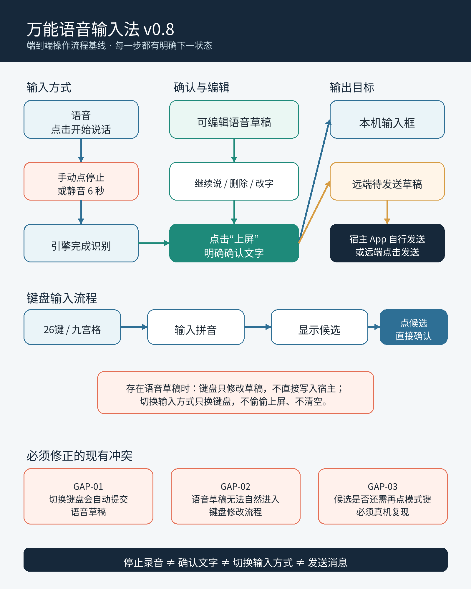
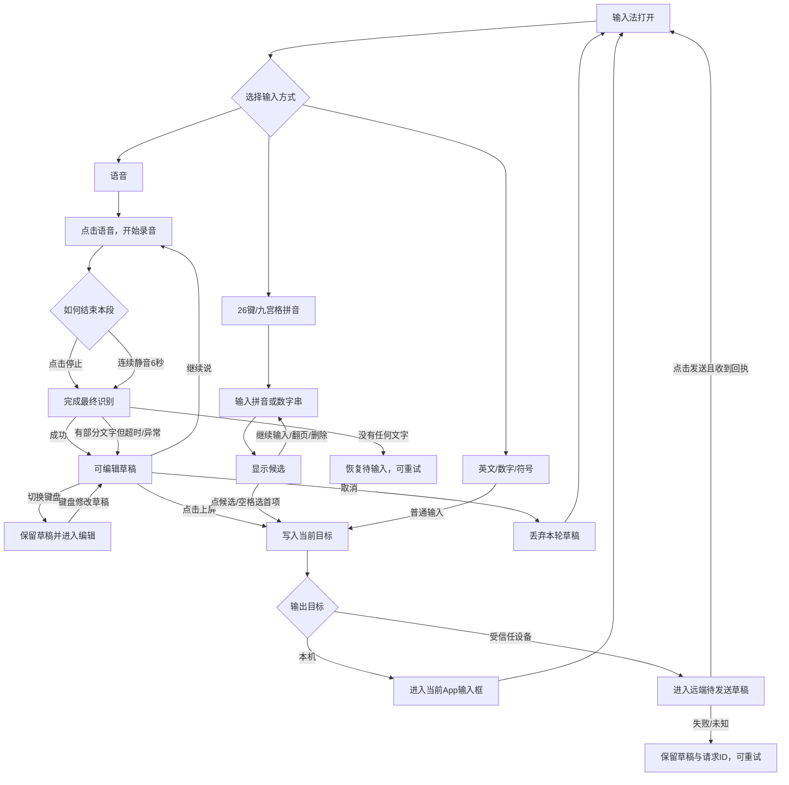

# 万能语音输入法 v0.8｜端到端操作流程基线

日期：2026-10-15  
状态：`DESIGNED / CODE_GAP_REVIEWED / DEVICE_REVALIDATION_PENDING`

本文不是界面说明，也不是代码状态机说明。它规定用户每完成一步操作后，软件必须进入什么状态、显示什么、文字保存在哪里，以及失败后如何继续。代码和测试必须服从本文。

## 1. 总原则

1. **输入方式**与**输出目标**是两条独立轴：语音、九宫格、26键和符号决定“怎么产生文字”；本机或受信任设备决定“文字去哪里”。
2. **停止录音**、**确认文字**、**切换输入方式**是三个不同动作，不能相互代替。
3. “上屏”只把文字写入当前输入框，不等于发送微信、短信或其他消息。
4. 没有经过用户确认的语音文字始终是草稿；模式切换不得偷偷上屏。
5. 切换App或输入框后，旧会话不得把文字带进新输入框。
6. 任一步失败都必须回到可继续操作的状态，不能卡在“识别中”。

## 2. 总流程图

## 3. 语音输入逐步流程

| 步骤 | 当前状态 | 用户操作或自动触发 | 界面反馈 | 文字保存位置 | 下一状态 |
| --- | --- | --- | --- | --- | --- |
| V01 | 待输入 | 点击左侧“语音” | 按钮变“停止”，显示正在收音 | 当前输入会话的临时识别区 | 正在录音 |
| V02 | 正在录音 | 用户说话 | 中间区域更新临时识别文字和录音状态 | 临时识别区，不上屏、不记历史 | 正在录音 |
| V03-A | 正在录音 | 点击“停止” | 显示“正在完成识别” | 保留当前可见文字 | 正在识别 |
| V03-B | 正在录音 | 连续静音达到6秒 | 自动执行与“停止”相同的动作 | 保留当前可见文字 | 正在识别 |
| V04 | 正在识别 | 引擎返回最终文字 | 显示可编辑文字，并显示“上屏” | 当前输入框专属语音草稿 | 待确认 |
| V05-A | 待确认 | 点击“语音” | 原草稿保留，开始下一段录音 | 原草稿成为追加前缀 | 正在录音 |
| V05-B | 待确认 | 点击草稿、删除或用键盘修改 | 光标和内容同步变化 | 仍在当前语音草稿 | 待确认 |
| V05-C | 待确认 | 点击“上屏” | 草稿写入当前目标，草稿清空 | 本机输入框或远端草稿 | 待输入 |
| V05-D | 待确认 | 点击“取消” | 明确提示本轮草稿已取消 | 清空当前草稿 | 待输入 |

### 语音异常分支

| 异常 | 必须发生的行为 | 禁止行为 |
| --- | --- | --- |
| 8秒没有检测到说话 | 结束本轮并提示未检测到语音，立即允许重试 | 一直显示录音中 |
| 停止后15秒没有最终结果 | 有可见文字则进入待确认；没有文字则恢复待输入 | 卡死、清除已有文字 |
| 本地引擎报错或断开 | 保留已显示草稿，显示错误并允许继续说/编辑/取消 | 强制退出输入法 |
| 切换App或换输入框 | 使旧回调失效；旧文字绝不能进入新输入框 | 把上一个App的草稿带过来 |
| 输入法被收起后重新打开同一输入框 | 未确认草稿可以恢复到原输入框会话 | 恢复到其他输入框 |

## 4. 拼音26键与九宫格流程

| 步骤 | 当前状态 | 用户操作 | 界面反馈 | 文字处理 | 下一状态 |
| --- | --- | --- | --- | --- | --- |
| P01 | 待输入 | 点击“26键”或“九宫格” | 对应键盘高亮 | 不产生文字 | 键盘就绪 |
| P02 | 键盘就绪 | 输入拼音字母或九宫格数字 | 显示组字串与候选 | 仅组字，不上屏 | 候选择字 |
| P03-A | 候选择字 | 点击候选 | 候选文字确认 | 无语音草稿时直接写入当前目标 | 键盘就绪 |
| P03-B | 候选择字 | 点击空格 | 选择第一候选 | 与点第一候选相同 | 键盘就绪 |
| P03-C | 候选择字 | 删除、继续输入或翻页 | 更新组字和候选 | 不上屏 | 候选择字 |
| P04 | 键盘就绪 | 点击回车 | 调用当前App定义的下一步/发送/换行 | 不重复提交候选 | 键盘就绪 |

当用户正在修改语音草稿时，键盘输入和候选选择只修改中间草稿；最终仍由“上屏”确认。没有语音草稿时，点候选本身就是明确确认，不需要再点一次“九宫格”或“26键”。

## 5. 英文、数字和符号流程

| 场景 | 按键行为 |
| --- | --- |
| 普通直接输入 | 字符直接进入当前本机输入框或远端草稿 |
| 修改语音草稿 | 字符插入草稿光标位置，不直接进入宿主输入框 |
| 删除 | 优先删除当前组字；其次删除草稿光标前字符；没有草稿时删除宿主光标前字符 |
| 切换输入方式 | 只切换键盘并保留当前草稿，不自动上屏、不清空 |

## 6. 输出目标流程

| 当前目标 | 输入确认后的去向 | 最终动作 |
| --- | --- | --- |
| 本机 | 当前有效输入框 | “上屏”或候选确认后结束；是否发送消息由宿主App决定 |
| 受信任设备 | 输入法内的远端待发送草稿 | 用户点击“发送”，收到回执后清除已发送部分 |

切换本机/远端目标时，如果存在未确认语音草稿、拼音组字或待发送远端草稿，必须先处理当前内容。不得把文字静默搬到另一个目标，也不得丢弃。

## 7. 首次启用与日常入口

| 流程 | 操作结果 |
| --- | --- |
| 首次安装 | 打开管理中心，依次完成“启用输入法”和“选择万能输入法”；不自动修改系统默认输入法 |
| 日常使用 | 用户在任意普通输入框调出万能输入法，默认进入语音待输入状态 |
| 密码或敏感输入框 | 强制本机；关闭语音、历史、学习和跨设备输出，只显示安全键盘 |
| 功能二级页 | 可查看设备、输入记录和设置；返回后恢复同一个编辑会话，不改变文字 |

## 8. 当前代码差异清单

| 编号 | 目标流程 | 当前代码行为 | 结论 |
| --- | --- | --- | --- |
| GAP-01 | 切换输入方式只切键盘并保留草稿 | `switchMode()` 会调用 `commitPreviewBeforeModeSwitch()`，把语音草稿自动上屏 | 必须修改 |
| GAP-02 | 键盘可编辑待确认语音草稿 | 当前切换前已自动上屏，无法形成连续编辑流程 | 必须修改 |
| GAP-03 | 点击候选即可确认，无需再点模式键 | 代码中的 `selectCandidate()` 已直接确认；若真机仍需再点，属于需复现的实现故障 | 真机复测 |
| GAP-04 | 停止录音和上屏是两个明确动作 | 代码已有“停止”和“上屏”，但模式按钮能隐式上屏，破坏动作边界 | 必须修改 |
| GAP-05 | 默认语音 | 代码 `voiceMode=true` 且非敏感输入框默认语音 | 需真机复测冷启动/换App |
| GAP-06 | 静音自动结束 | 当前为连续静音6秒，不是10秒 | 保持6秒，后续以真机体验决定 |
| GAP-07 | 新输入框不串字 | generation隔离已有代码与测试，历史曾出现串字 | 增加真实跨App验收 |
| GAP-08 | 手动停止与静音停止只能结算一次 | 当前需要补充并发触发验收 | 增加幂等测试 |
| GAP-09 | 识别结束、错误或取消后麦克风必须释放 | 有生命周期代码，缺少完整流程验收 | 增加连续两轮录音测试 |
| GAP-10 | 远端无回执不能永久显示“发送中” | 有失败恢复与同请求ID重试设计 | 增加断网与超时真机验收 |
| GAP-11 | 切换键盘后不得残留旧候选 | 当前候选由键盘状态驱动 | 增加26键/九宫格交叉切换测试 |

## 9. 验收脚本

每条流程必须在两个普通App输入框中各走一遍，记录：开始状态、每次点击、界面文字、最终输入结果和是否残留旧草稿。最低验收组合：

1. 语音自动停止 → 修改 → 上屏；
2. 语音手动停止 → 继续说 → 上屏；
3. 语音草稿 → 26键修改 → 上屏；
4. 语音草稿 → 九宫格修改 → 上屏；
5. 26键输入 → 选词；
6. 九宫格输入 → 选词；
7. 输入过程中切换App；
8. 识别超时、错误与取消；
9. 本机与远端目标各完成一次；
10. 密码字段不出现语音、历史或远端能力。

任一项出现多余点击、无反馈、文字丢失、串字或无法退出，均不得标记流程通过。

## 10. 本轮会审记录

- Codex：对照当前源码与用户实际操作，建立端到端流程、操作表和代码差异清单。
- Jev：判定为低风险产品流程梳理，由Codex执行并验证，不涉及系统权限。
- Claude：确认统一状态应为“待输入→录音→识别→草稿→提交”，并补充停止动作幂等、麦克风释放、远端发送超时和候选残留四类死路，已加入GAP-08至GAP-11。
- Google通道：本轮不等待外部网页咨询；进入实际交互改版前，按项目规则再进行效果与Android约束复核。未将缺席写成会审通过。
